# 无人清扫车：多模态感知、定位与作业规划

**面向低速清扫的算法与系统开发项目，2026。** 将多模态环境理解、自建地图定位、工具约束规划与车辆执行组织为可追溯的作业链，在 CARLA 和离线实验中分别验证。

本仓库提供精选实现、实验结果与轻量回放。阅读顺序：[系统结构](#系统结构) → [结果](#已验证结果) → [源码](#源码入口) → [运行示例](docs/reproduction.md)。简历文本见[简历稿](docs/resume.zh-CN.md)。

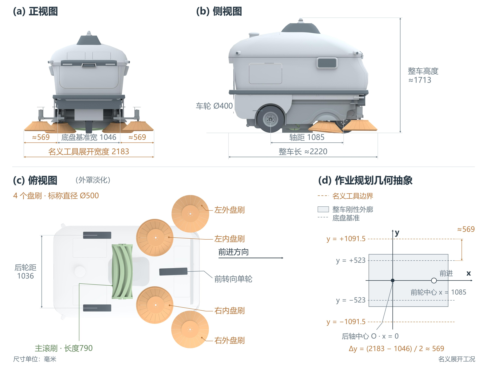

三轮无人化改型与五刷布置的设计示意：几何参数来自 CAD 量取，工具展开宽度不等于实测清洁宽度。图片来自《技术方案报告》图 2-1。

## 车辆与传感器

车辆以现有驾驶式清扫车为基础，保留四盘刷与主滚刷，设计无人化机身、传感器安装与控制接口。以下为改型装配设计和传感器布置示意，实物安装与标定另行验证。

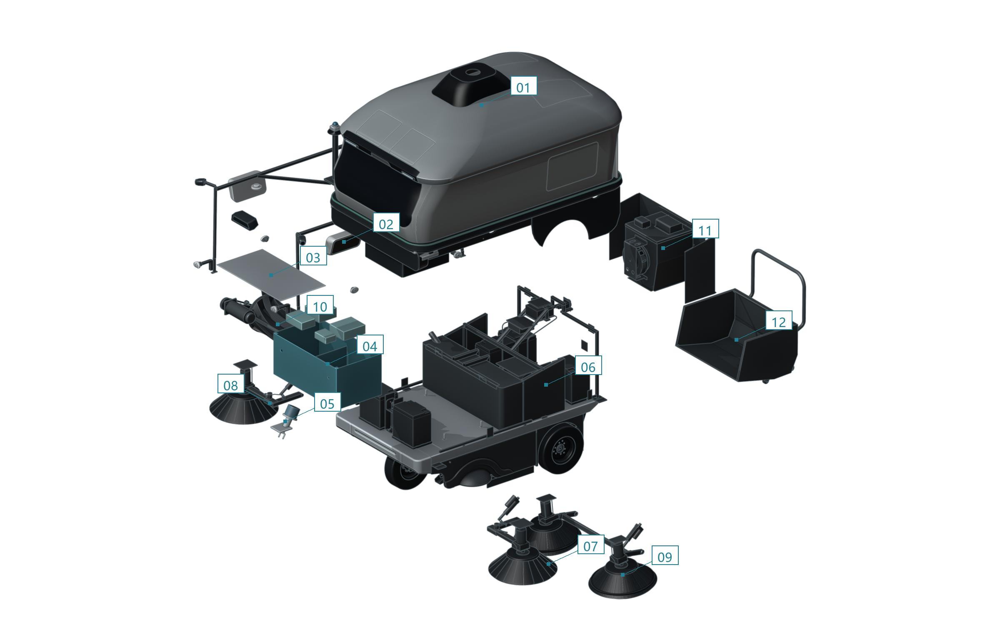

*整车改型总装分解，展示机身、底盘、刷具与收集系统的功能分组。报告图 2-2。*

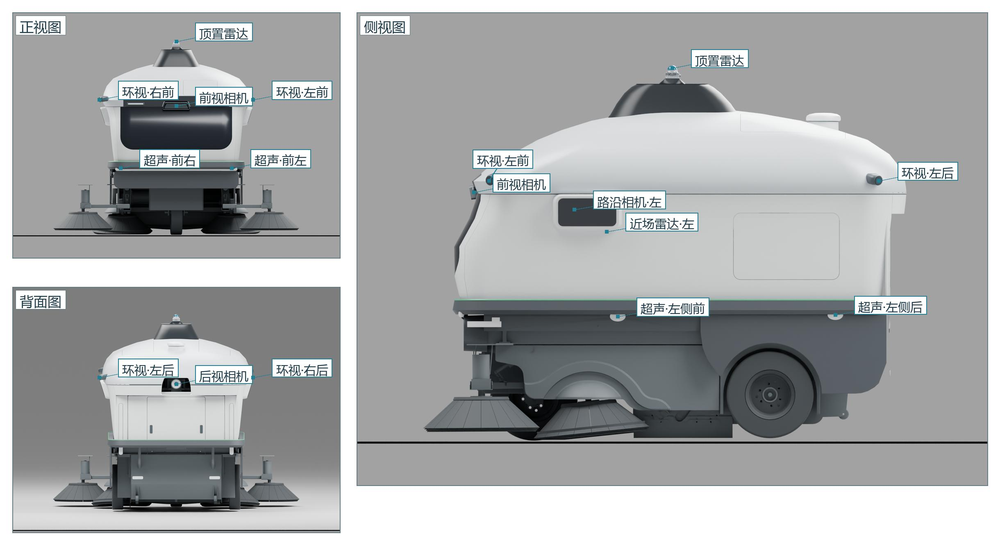

*传感器布置设计：六路环视、顶置与侧向近场 LiDAR、路沿相机和超声波。报告图 2-4；仿真使用替代扫描模型。*

## 系统结构

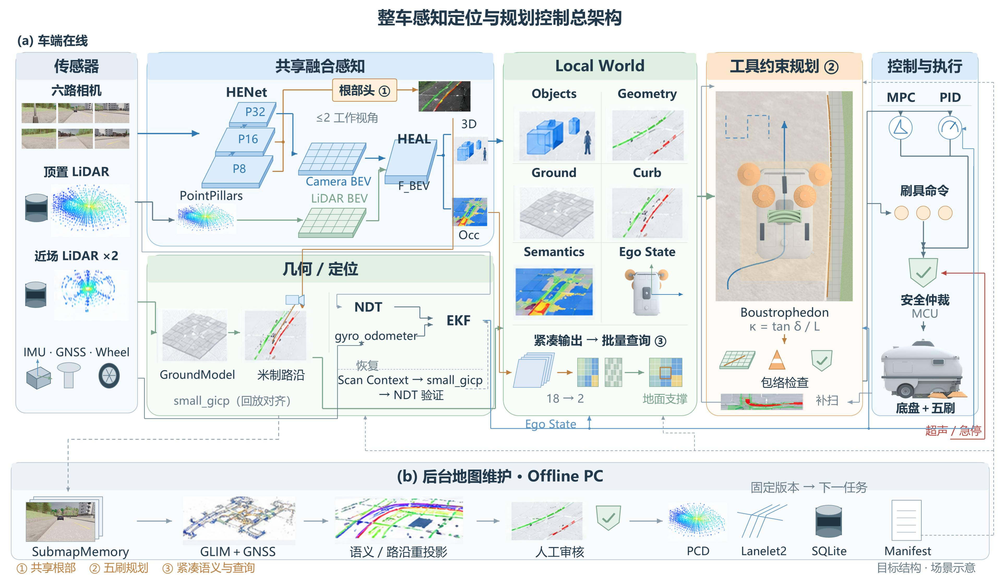

*目标系统架构与后台地图维护流程。报告图 2-6；各组件的当前验证范围见下表及实验记录。*

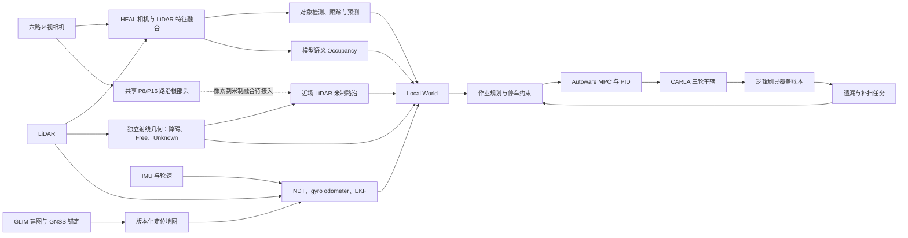

对象链提供检测、跟踪和预测；几何链保留独立观测的障碍、空闲与未知；路沿链提供作业参考；定位链提供车辆状态。Local World 供规划消费。模型语义与实测几何保留各自来源，未观测区域保持 Unknown。

## 关键技术

### 共享路沿根部感知

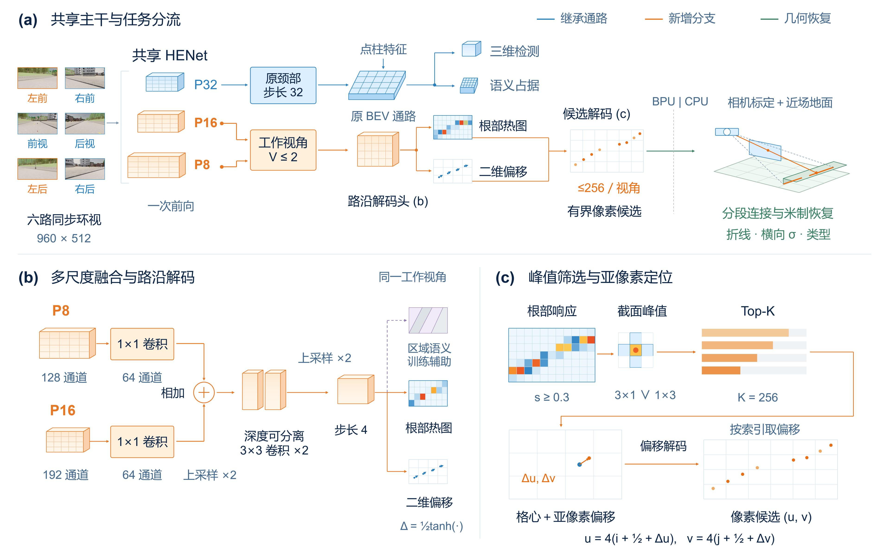

*复用图像主干 P8/P16 特征，输出有界像素候选，再由 CPU 进行连接与几何恢复。报告图 3-2 为方法示意；像素到米制融合仍待接入完整链路。*

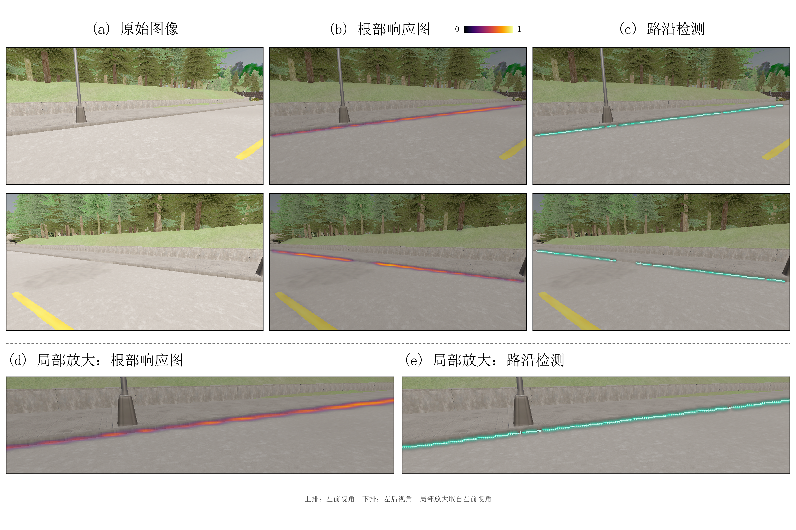

### 五刷工具约束与行末机动

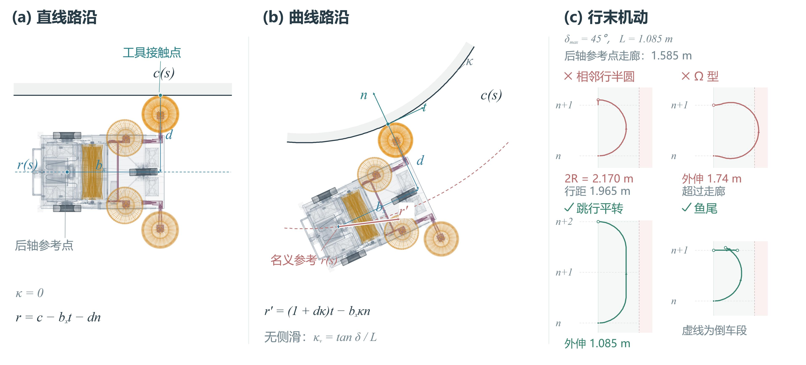

*工具接触与车辆后轴参考的几何关系，以及行末机动的参考点检查。报告图 3-6；完整车具扫掠和转向动态另行验证。*

## 已验证结果

| 模块与实验 | 结果 | 条件与证据 |
| --- | --- | --- |
| 自建底图与独立 NDT | 3 km 建图；约 415 万点、380 个瓦片；独立会话横向 P95 为 **6.69 cm / 8.78 cm** | Town01；实时输入 877 帧、留出回放 1,230 帧；[定位证据](docs/evidence.md#定位与地图) |
| 共享图像路沿头 | 两工作视角复用 P8/P16；模型前向中位数增加 **0.72 ms**；581 帧回放原检测与 Occupancy 类别输出一致 | RTX 4090 D；冻结主干、同路段会话留出；[共享头证据](docs/evidence.md#共享路沿头) |
| 离线覆盖规划 | L 形 G3：**80.53% → 99.88%**；任务耗时 **397.72 → 661.46 s** | 五刷 CAD 足迹、四轮反相 **4WS** 基线、5 cm 栅格；同 397.72 s 预算为 80.53% / 92.26%；[覆盖证据](docs/evidence.md#离线覆盖规划) |
| 在线路沿驾驶 | 14 m 直线任务：独立真值前进 **13.8948 m**；遇障停车、移除后恢复、终点停稳；碰撞 **0** | 理想化 LiDAR、自车回波简化处理、刷具关闭；[驾驶证据](docs/evidence.md#在线路沿驾驶) |
| 垃圾驱动作业 | 空目标全覆盖、取消注入遗漏、补扫三段通过；补扫面目标 **100%**、远点覆盖、待处理格归零 | 场景真值目标、三轮车、逻辑示例刷具；[作业证据](docs/evidence.md#垃圾驱动作业) |

这些实验分别评价定位组件、图像分支、离线几何规划和受限场景驾驶。图像根部的米制融合、完整复合作业、J6 全栈与实体清洁效果仍待验证。Scan Context → small_gicp → NDT 是已设计的恢复路线，当前展示指标来自正常 NDT 定位。

## 源码入口

| 关注点 | 入口 | 本仓库中的用途 |
| --- | --- | --- |
| Local World 与三维射线 | [world.py](src/perception/local_world/world.py)、[raycast.py](src/perception/local_world/raycast.py) | 阅读空间证据组织、观测过期与射线体素遍历 |
| 有地面支撑的米制路沿 | [curb_geometry.py](src/perception/curb_geometry.py) | 可运行的 NumPy 核；缺列分段、根部夹区、RAISED/FLUSH/RAMP |
| 共享图像路沿分支 | [curb_head.py](src/perception/heal/curb_head.py)、[shared_model.py](src/perception/heal/shared_model.py) | 阅读 P8/P16 特征复用、热图/偏移与有界候选 |
| 三轮点/面目标规划 | [litter_routes.py](replay/simulation/carla-autoware/scripts/litter_routes.py)、[tricycle_navigation.py](replay/simulation/carla-autoware/scripts/tricycle_navigation.py) | 冻结源码和真实任务快照，可离线重算 |
| 五刷工具约束覆盖 | [coverage_planning.py](reference/offline_coverage/coverage_planning.py)、[coverage_execution.py](reference/offline_coverage/coverage_execution.py) | 原 4WS 实验源码快照，供阅读 A/B/C 方法与执行约束 |

源码路径与原件 SHA-256 见 [provenance.json](provenance.json)。`replay/` 为已验证的规划切片；`reference/` 为算法参考快照，完整 Fields2Cover 实验另需原生库、输入与评价器。`src/` 为精选感知实现，HEAL 接线需原框架、模型和标定数据。

## 结果图

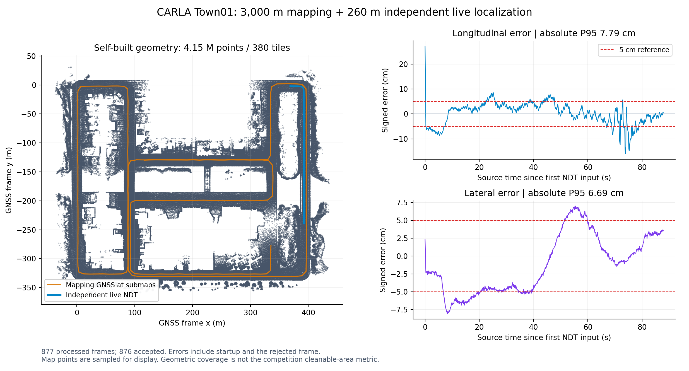

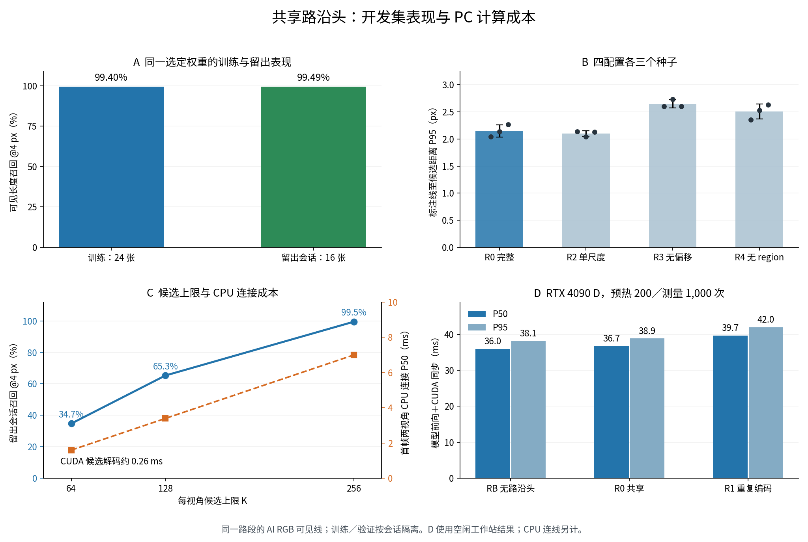

| 常规条带 A | 工具约束搜索 C |
| --- | --- |
| 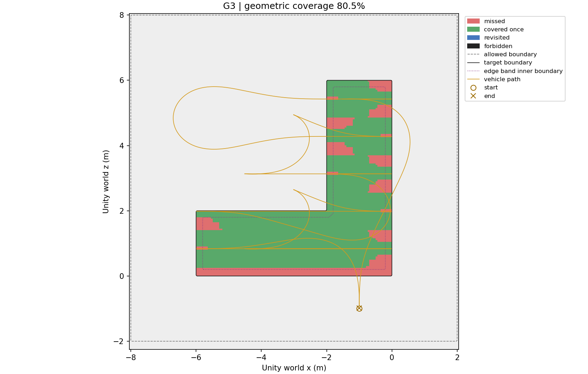 | 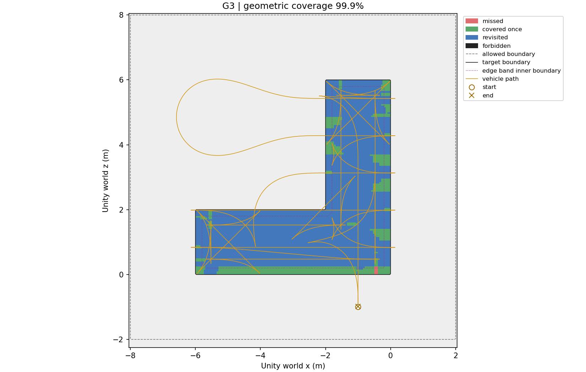 |

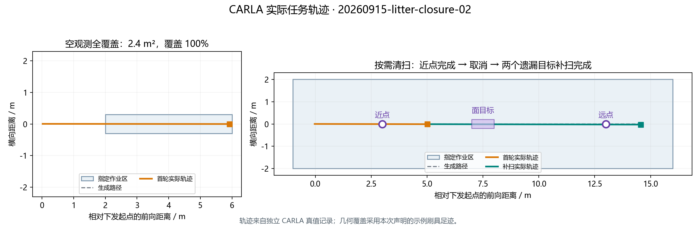

## 运行与核验

Python 3.10–3.12 可运行 NumPy 路沿例和原有组件测试；Linux Python 3.12 可运行冻结任务规划回放。详见[复现说明](docs/reproduction.md)。本次导出检查见 [validation.json](validation.json)。

第三方框架与素材的归属见 [NOTICE.md](NOTICE.md)。展示包保留项目自有实现、数值证据和结果图；训练权重、HBM、SDK、CAD 原件及大规模传感器包由各自来源管理。
